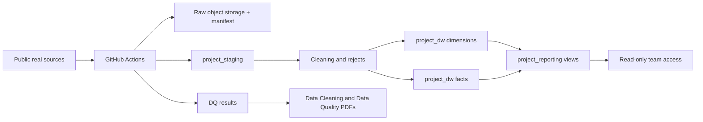

# Architecture and Platform

## Status

This architecture is the accepted Phase 2 baseline. The Neon project, database,
bucket, roles, and GitHub environment exist; the application schemas, ETL code, and
workflows are not implemented yet. Platform decisions were confirmed at `G1`; see
[DECISIONS.md](../DECISIONS.md).

## Design goals

- One shared warehouse that all five members can read.
- Real public data end to end.
- No local PostgreSQL, Docker, or machine-local dependency.
- Free-tier only, with no credit card.
- Reproducible weekly/manual refreshes.
- Raw data preserved outside Git.
- Clear lineage from source row to fact row.
- Operational simplicity for a five-person student team.

## Accepted platform

| Component | Choice | Role |
|---|---|---|
| Warehouse | Neon Free PostgreSQL, `aws-us-east-2` | Shared `project_staging`, `project_dw`, `project_reporting` |
| Raw archive | Neon Object Storage, private bucket | Raw source files and snapshots with a provenance manifest |
| Orchestration | GitHub Actions | Weekly schedule, manual dispatch, tests, report publishing |
| Runtime | Python 3.11 | Parsing, cleaning, loading, DQ, PDF generation |
| Database driver | `psycopg2` | SQL execution from CI |
| Object access | `boto3` | S3-compatible raw archive access |
| Spatial processing | `shapely` | Polygon containment in Python, no PostGIS dependency |
| Reports | ReportLab | Data Cleaning and Data Quality PDFs |
| Team access | Neon organization + read-only SQL role | Shared read access |

### Why Neon

- Free plan requires no credit card.
- Unlimited organization members.
- 1 GB PostgreSQL storage per project and 20 GB account total.
- 5 GB object storage per project.
- 100 CU-hours per project per month.
- Scale-to-zero after inactivity, without an inactivity pause that requires manual
  restore.
- Object storage in the same project and supported region.

These limits were confirmed at `G1`. If a limit changes or is insufficient, stop and
ask the human for a capacity decision.

### Rejected alternatives

| Alternative | Reason not selected |
|---|---|
| Aiven Free PostgreSQL | Powers off after inactivity; poor shared availability |
| Supabase Free | 500 MB storage and pauses after one week |
| Cloudflare R2 | R2 subscription/checkout may require a card |
| Local PostgreSQL | Explicitly prohibited |
| Docker-based services | Explicitly prohibited |
| Paid Neon/Aiven/Supabase | Card/billing constraint |

## Target data flow



### Stage responsibilities

| Stage | Responsibility | Canonical detail |
|---|---|---|
| Source acquisition | Fetch real files; record URL, license, hash, size, fetch time | [03_data_sources_and_licensing.md](03_data_sources_and_licensing.md) |
| Raw archive | Preserve immutable source snapshots outside Git | [07_operations_access_and_security.md](07_operations_access_and_security.md) |
| Staging | Typed staging tables, normalization, deduplication, reject reasons | [05_etl_pipeline.md](05_etl_pipeline.md) |
| Dimension load | Natural-key to surrogate-key mapping, unknown members | [04_data_model.md](04_data_model.md) |
| Fact load | Grain-compliant inserts with dimension keys and provenance | [04_data_model.md](04_data_model.md) |
| Reporting | Views for the ten business questions | [04_data_model.md](04_data_model.md) |
| Quality | Completeness, accuracy, integrity, reconciliation, timeliness | [06_data_quality_and_reports.md](06_data_quality_and_reports.md) |

## Schemas

### `project_staging`

Holds source-shaped, typed records, source manifests, rejects, ETL run logs, and DQ
results. It is allowed to contain duplicate or invalid records; cleaning status must
be explicit. Raw JSON payloads are avoided for accepted high-volume rows and reserved
for rejected rows or small reference data.

### `project_dw`

Holds the six dimensions and five facts. It contains only grain-compliant, keyed
records with source provenance. Unknown members use key `-1`.

### `project_reporting`

Holds views, not base tables, for the ten business questions. Views must be stable
enough for Phase 3 BI tools and ad hoc queries.

## Logical layers

```text
Public sources
    -> raw archive (object storage + manifest)
    -> project_staging (typed, cleaned, rejected)
    -> project_dw (dimensions + facts)
    -> project_reporting (analytical views)
    -> read-only team access / Phase 3 BI
```

## Surrogate keys and lineage

- Every dimension has an identity surrogate key and a unique natural key.
- Every dimension has unknown member `-1`.
- Facts reference surrogate keys, never source business keys as their primary foreign
  keys.
- Every fact carries `source_system`, `source_record_id`, `etl_run_id`, and
  `loaded_at`.
- `project_staging.source_manifest` records the raw source artifact.
- Derived facts carry an algorithm version so the calculation is reproducible.

## Access model

| Principal | Database access | Object storage | GitHub |
|---|---|---|---|
| Human owner | Admin through Neon/GitHub UI | Admin through Neon UI | Admin |
| Member A (platform) | Write through CI only; read for verification | Read/write through CI secret | Write via PR |
| Members B-E | Read-only SQL role; read-only storage credential if needed | Read-only | Write via PR |
| GitHub Actions | Write database role | Read/write | Workflow token |
| Public | No database or storage access | No access | Public code repository |

The human creates roles, credentials, and memberships. Agents must never ask for or
print secret values. See [07_operations_access_and_security.md](07_operations_access_and_security.md).

## Security boundaries

- The repository is public for free GitHub Actions. Do not commit secrets or raw
  data.
- The warehouse and object bucket are private.
- The read-only role cannot create, update, or delete.
- CI uses a protected GitHub environment with required reviewers if available.
- Secrets are masked in logs.
- Raw data licenses and attribution are documented; restricted data is not added.

## Free-tier capacity budget

| Resource | Free limit | Phase 2 budget | Guard |
|---|---|---|---|
| PostgreSQL storage | 1 GB/project | Target < 500 MB | Cap tracking window; no raw JSON in DW |
| Object storage | 5 GB/project | Target < 2 GB | Archive selected real sources only |
| Compute | 100 CU-hours/project/month | Target < 30 hours | Weekly run plus member queries |
| Egress | 5 GB/project | Team queries DB, not raw archive | Share original public URLs |
| GitHub Actions | Free for public repo | Weekly + manual | No five-minute polling |

If a budget is at risk, stop and ask the human. Do not upgrade a plan.

## Failure behavior

| Failure | Required behavior |
|---|---|
| Optional source unavailable | Record a gap; continue only if required facts remain valid |
| Required source unavailable | Fail the run; keep previous warehouse state; ask human if persistent |
| Schema drift | Fail validation; do not guess column mapping |
| Raw archive over quota | Stop before upload; ask human for retention decision |
| Database over quota | Stop; do not delete production data without human approval |
| Critical DQ failure | Fail the workflow; publish the report; do not mark data as trusted |
| Secret missing | Block on human action; never request the secret in chat |

## Non-goals

- Real-time streaming.
- High-availability or production SLA.
- Multi-tenant security.
- Paid storage or compute.
- Local database development.
- Phase 3 dashboard implementation.

## Resolved decisions

- Neon Free and `aws-us-east-2` are accepted (`D-001`).
- Object-storage bucket `aerogrid-raw` and retention are accepted (`D-003`, `H-003`).
- Multi-site scope and `dim_site` are accepted (`D-010`).
- Weekly Monday 06:00 UTC schedule and manual dispatch inputs are accepted (`D-019`).
- Reports are published as Action artifacts (`D-019`).
