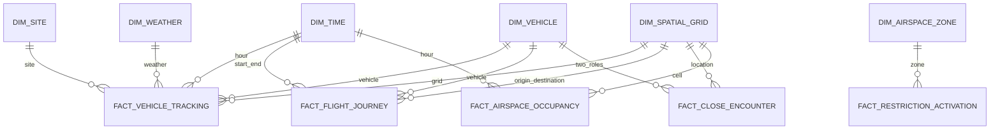

# Logical Data Model

<!-- AEROGRID_ADMIN_CLOSEOUT_2026_11_13 -->
**Current administrator-declared acceptance (2026-11-13):** The requester states they hold project-administrator authority and explicitly accepts G5, G6, and G7. This documents their decision, **not** independent confirmation of a full G7 end-to-end replay, all five members testing reader access, or finished WP-11/WP-12 technical evidence. Those proof items remain listed separately in the [Final gate record](FINAL_ACCEPTANCE_G5_G6_G7_2026-11-13.md)..

**Member E deployment facts:** WP-07 through WP-10 are merged: 27,479 source-linked tracking facts, 178 journeys, 3,658 real 2D grid cells, 1,754 occupancy facts; 32 persisted DQ results (29 PASS, 3 WARN, 0 FAIL); 10 reporting views; both improved PDFs. The deployed encounter and restriction fact counts are zero, with documented coverage and algorithm limitations.
<!-- /AEROGRID_ADMIN_CLOSEOUT_2026_11_13 -->

This document is the canonical Phase 2 logical model. It refines the frozen Phase 1
design for real, multi-site data and the Phase 2 rubric. Column-level details live in
[`../../data/data_dictionary.md`](../../data/data_dictionary.md). The visual mirror
is [`../../data/diagrams/aerogrid_schema.dbml`](../../data/diagrams/aerogrid_schema.dbml).

## Model summary

- Six dimensions: `dim_time`, `dim_site`, `dim_vehicle`, `dim_spatial_grid`,
  `dim_weather`, `dim_airspace_zone`.
- Five facts: `fact_vehicle_tracking`, `fact_flight_journey`,
  `fact_close_encounter`, `fact_restriction_activation`,
  `fact_airspace_occupancy`.
- One star schema. No snowflake tables are required.
- All dimensions use identity surrogate keys and a `-1` unknown member.
- Facts carry exact event timestamps, surrogate keys, source provenance, and the ETL
  run identifier.
- Derived facts are computed only from real tracking rows.

## Phase 1 deltas

| Phase 1 baseline | Phase 2 refinement | Reason |
|---|---|---|
| Five dimensions | Add `dim_site` | Real UAS data is not co-located with Pittsburgh ADS-B |
| `time_key` encoded `YYYYMMDDHH` | Identity `time_key` plus unique `hour_ts` | Proper surrogate key and unambiguous hourly grain |
| Fact grain said exact timestamp but no exact column | Add `event_ts` / `start_ts` / `end_ts` | Preserve exact event time while joining an hourly time dimension |
| Source identifiers implicit | Add `source_system`, `source_record_id`, `etl_run_id` | Lineage and idempotent reloads |
| One altitude in feet MSL | Add MSL and AGL fields plus datum/source | Tartan and DJI expose different altitude datums |
| Weather linked by time/grid only | Add explicit `weather_key` | Enforceable star join and null policy |
| Journey had one time key | Add start/end time keys, timestamps, origin/destination grids | Correct journey grain |
| Restriction had no effective window | Add effective start/end and active flag | Distinguish static zones from active events |
| No unknown members | Add `-1` unknown rows | Preserve facts with unresolved optional dimensions |
| No reporting schema | Add `project_reporting` views | Required Phase 2 layer |

## Conventions

| Topic | Rule |
|---|---|
| Time zone | Store timestamps as `TIMESTAMPTZ` in UTC; display is a reporting concern |
| Altitude | Store `altitude_msl_ft` when known; store `altitude_agl_ft` when known; never silently mix datums |
| Horizontal distance | Nautical miles in facts; compute with a geodesic or documented approximation |
| Speed | Knots in facts; convert source MPH/m/s during staging |
| Coordinates | WGS84 latitude/longitude, six or more decimal places in staging |
| Surrogate keys | `BIGINT GENERATED BY DEFAULT AS IDENTITY`; never reuse keys |
| Unknown member | `-1` in every dimension; insert once during seed |
| Natural keys | Unique constraints; used for idempotent dimension upserts |
| Slowly changing dimensions | Type 1 for Phase 2; keep `first_seen_ts`/`last_seen_ts` on vehicles and zones where useful |
| Null policy | Optional unresolved dimension uses `-1`; unknown measure uses `NULL`, never zero |
| Provenance | Every fact row has source and ETL lineage |
| Raw JSON | Keep high-volume raw payloads out of `project_dw`; rejected rows may retain a payload in staging |

## Dimension overview

### `dim_time`

Hourly calendar dimension covering the full data range. Fact rows carry exact
timestamps and join to the hour row.

Key columns:

- `time_key` (surrogate PK)
- `hour_ts` (unique natural key, UTC)
- `full_date`, `year`, `quarter`, `month`, `month_name`, `day_of_month`,
  `day_of_week`, `hour_of_day`, `is_weekend`, `time_of_day_band`

Grain: one row per UTC hour.

### `dim_site`

Analytical site/region dimension. This is the Phase 2 addition.

Key columns:

- `site_key` (surrogate PK)
- `site_code` (unique natural key: `KBTP`, `KAGC`, `NIGHTJAR_PA`, `DJI_CO`,
  `DJI_CA`)
- `site_name`, `site_type`, `city`, `state`, `country`
- `latitude`, `longitude`
- `bbox_min_lat`, `bbox_min_lon`, `bbox_max_lat`, `bbox_max_lon`
- `source_system`, `description`

Grain: one row per monitored site or analytical region.

### `dim_vehicle`

Unified aircraft and UAS dimension.

Key columns:

- `vehicle_key` (surrogate PK)
- `source_system` + `source_entity_id` (unique natural key pair)
- `icao24`, `serial_number`, `callsign`, `registration_number`
- `vehicle_category`, `vehicle_subcategory`, `operator_name`, `engine_type`
- `first_seen_ts`, `last_seen_ts`

Grain: one row per real vehicle identity in a source system. A vehicle known from
multiple sources may produce multiple source-scoped rows in Phase 2; do not merge
identities without evidence. The reporting layer may group by ICAO24 or serial.

### `dim_spatial_grid`

3D grid per site.

Key columns:

- `grid_key` (surrogate PK)
- `grid_cell_id` (unique natural key)
- `site_key`
- `latitude_center`, `longitude_center`
- `latitude_min`, `latitude_max`, `longitude_min`, `longitude_max`
- `altitude_band_name`, `altitude_min_ft`, `altitude_max_ft`
- `cell_size_deg`, `altitude_band_order`

Grain: one row per horizontal cell and altitude band per site. Cells with no observed
traffic may still exist as dimension rows; facts only reference cells that contain
real positions.

### `dim_weather`

Real METAR observation dimension.

Key columns:

- `weather_key` (surrogate PK)
- `station_icao` + `observation_ts` (unique natural key)
- `site_key` (nearest/primary site association; `-1` if no association)
- `raw_text`, `flight_category`
- `temperature_c`, `dewpoint_c`
- `wind_speed_kts`, `wind_gust_kts`, `wind_direction_deg`
- `visibility_sm`, `cloud_ceiling_ft`, `altimeter_inhg`
- `source_system`

Grain: one row per station observation time. Do not create a weather row without a
real observation.

### `dim_airspace_zone`

FAA restriction and airspace polygon dimension.

Key columns:

- `zone_key` (surrogate PK)
- `source_system` + `source_object_id` (unique natural key pair)
- `site_key` (`-1` when the zone is not site-specific)
- `restriction_id`, `zone_name`, `restriction_type`
- `lower_limit_ft`, `upper_limit_ft`
- `effective_start_ts`, `effective_end_ts`, `is_static`
- `geometry_wkt`, `bbox_min_lat`, `bbox_min_lon`, `bbox_max_lat`, `bbox_max_lon`
- `source_url`, `first_seen_ts`, `last_seen_ts`

Grain: one row per source polygon/feature version used in the study. Type 1 updates
are acceptable in Phase 2.

## Fact overview

### `fact_vehicle_tracking`

Grain: one real position report from one vehicle at one exact timestamp.

Key columns:

- `tracking_id` (surrogate PK)
- `event_ts`, `time_key`
- `site_key`, `vehicle_key`, `grid_key`, `weather_key`
- `altitude_msl_ft`, `altitude_agl_ft`, `altitude_source`
- `ground_speed_kts`, `heading_deg`, `vertical_rate_fps`, `on_ground`
- `source_system`, `source_record_id`, `source_file`, `source_quality_flag`
- `etl_run_id`, `loaded_at`, `algorithm_version`

Uniqueness: `(source_system, source_record_id)` or an equivalent source-scoped
natural key, plus `event_ts` where needed.

### `fact_flight_journey`

Grain: one real flight or distinct ADS-B segment, from takeoff/entry to
landing/exit or a documented gap split.

Key columns:

- `journey_id` (surrogate PK)
- `vehicle_key`, `site_key`
- `start_ts`, `end_ts`, `start_time_key`, `end_time_key`
- `origin_grid_key`, `destination_grid_key` (`-1` when no grid applies)
- `flight_duration_sec`, `max_altitude_ft`, `total_distance_nm`,
  `avg_speed_kts`
- `journey_source`, `segment_reason`, `source_system`, `source_record_id`
- `etl_run_id`, `loaded_at`, `algorithm_version`

Uniqueness: source journey identifier or a deterministic segment key.

### `fact_close_encounter`

Grain: one detected conflict episode between two real vehicles at one site.

Key columns:

- `encounter_id` (surrogate PK)
- `start_ts`, `end_ts`, `start_time_key`
- `site_key`, `grid_key`, `weather_key`
- `vehicle_key_1`, `vehicle_key_2` (role-playing vehicle keys)
- `min_horizontal_sep_nm`, `min_vertical_sep_ft`
- `conflict_duration_sec`, `closing_speed_kts`, `risk_severity_class`,
  `risk_severity_score`
- `algorithm_version`, `etl_run_id`, `loaded_at`

Thresholds must be documented and approved. Proposed initial classes:

- Severe: horizontal < 0.5 nm and vertical < 500 ft.
- Proximity: horizontal < 1.0 nm and vertical < 1,000 ft.
- Only airborne positions from real tracking rows are eligible.
- Do not pair UAS flights with unrelated manned traffic from a different time/site.

Uniqueness: `(vehicle_key_1, vehicle_key_2, start_ts, algorithm_version)` with a
deterministic ordering of the two vehicle keys.

### `fact_restriction_activation`

Grain: one evaluation of one airspace zone at one time interval.

Key columns:

- `activation_id` (surrogate PK)
- `time_key`, `evaluation_ts`, `site_key`, `zone_key`
- `is_active`
- `affected_traffic_count`, `compliant_count`, `compliance_rate_pct`
- `source_system`, `source_record_id`, `source_snapshot_ts`
- `etl_run_id`, `loaded_at`, `algorithm_version`

Evaluation rules:

- A TFR is active only when a real snapshot or an effective window supports it.
- A UAS facility map ceiling is a standing restriction, not a synthetic TFR.
- Compliance for UAS positions means the position is within the zone and at or below
  the applicable ceiling; for manned TFR evaluation, use the published lower/upper
  limits.
- If the source does not provide a historical window, the report must state that the
  warehouse captures forward snapshots only.

Uniqueness: `(zone_key, evaluation_ts, source_system)`.

### `fact_airspace_occupancy`

Grain: one hourly utilization snapshot per grid cell and altitude band.

Key columns:

- `occupancy_id` (surrogate PK)
- `time_key`, `site_key`, `grid_key`
- `active_vehicle_count`, `total_occupancy_minutes`, `avg_traffic_speed_kts`
- `algorithm_version`, `etl_run_id`, `loaded_at`

Uniqueness: `(time_key, grid_key, algorithm_version)`.

## Relationships



The diagram is intentionally simplified. The physical schema must include all foreign
keys and uniqueness constraints documented in the data dictionary.

## Surrogate-key policy

1. Insert the `-1` unknown row in every dimension before loading facts.
2. Upsert dimensions on their natural keys.
3. Map facts with joins on natural keys.
4. Never derive a fact foreign key from a row number, hash, or timestamp.
5. If an optional dimension cannot be resolved, use `-1` and increment the relevant
   DQ completeness counter.
6. If a required dimension cannot be resolved, reject the fact row and record the
   reason.

## Provenance policy

Every fact must be traceable through:

```text
fact row
  -> source_system + source_record_id
  -> source_manifest (URL, license, SHA-256, fetched_at)
  -> raw object key
  -> staging accepted row
```

Derived facts are traceable through `algorithm_version` and the input fact grain. The
Data Cleaning Report must state that derived rows come from real tracking data.

## Reporting views

The `project_reporting` schema should contain stable views for:

1. Traffic density by hour and grid.
2. Longest-occupied grid/altitude bands.
3. Monthly traffic volume and average altitude.
4. Peak times and manned/UAS mix.
5. Close encounters per day and hotspot.
6. Vehicle categories and operators in encounters.
7. Restriction impact on traffic density.
8. Weather correlation with operations and encounters.
9. Corridor capacity inputs.
10. Candidate corridors with low traffic and few encounters.

Exact view names and definitions are owned by `WP-10` and must not be invented before
the facts are stable.

## Capacity considerations

- Target less than 500 MB in PostgreSQL.
- Keep raw JSON out of the high-volume fact tables.
- Use a documented Tartan load window; archive the full raw source separately.
- Index foreign keys and the most common time/site filters.
- Compute occupancy once per grid/hour, not per query.
- If the database approaches 1 GB, stop and ask the human before deleting or
  aggregating data.

## Model open questions

- Confirm the multi-site scope and `dim_site`.
- Confirm close-encounter thresholds.
- Confirm whether vehicle identities from different sources should be merged by
  ICAO24 or kept source-scoped.
- Confirm the Tartan load window.
- Confirm whether TFR history is sufficient or must be documented as forward-only.
