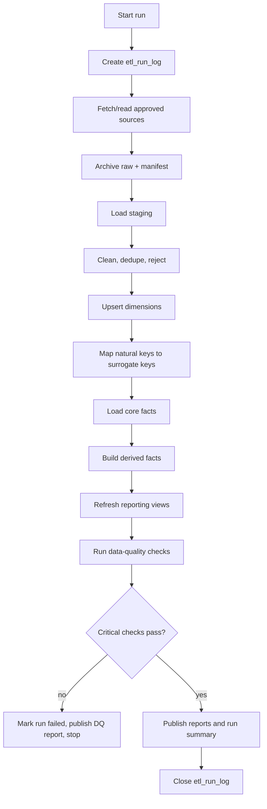

# ETL Pipeline Plan

<!-- AEROGRID_ADMIN_CLOSEOUT_2026_11_13 -->
**Current administrator-declared acceptance (2026-11-13):** The requester states they hold project-administrator authority and explicitly accepts G5, G6, and G7. This documents their decision, **not** independent confirmation of a full G7 end-to-end replay, all five members testing reader access, or finished WP-11/WP-12 technical evidence. Those proof items remain listed separately in the [Final gate record](FINAL_ACCEPTANCE_G5_G6_G7_2026-11-13.md)..

**Member E deployment facts:** WP-07 through WP-10 are merged: 27,479 source-linked tracking facts, 178 journeys, 3,658 real 2D grid cells, 1,754 occupancy facts; 32 persisted DQ results (29 PASS, 3 WARN, 0 FAIL); 10 reporting views; both improved PDFs. The deployed encounter and restriction fact counts are zero, with documented coverage and algorithm limitations.
<!-- /AEROGRID_ADMIN_CLOSEOUT_2026_11_13 -->

## Status

This is the implementation plan plus the delivered staging, dimension, and core-fact
packages. `WP-02`-`WP-06` are `DONE`: the staging DDL is applied on Neon (runs
`42474788058` and `42477720902`, two idempotent passes), the six dimensions, seeds,
and dictionary merged in PR #8, and the core tracking/journey facts merged in PR #12
(`f29b099`). The real Tartan WP-05 run `42689267328` and WP-06 run `42887782411`
passed, resolving `B-011` and recording `G4` on 2026-11-11. WP-07–WP-10 are deployed and merged; the requester explicitly accepted G5/G6/G7 on 2026-11-13. `WP-11`
implements the recurring ingestion job (`run.py`, `fetch.py`, `config.py`,
`dimension_loaders.py`, workflow `wp11-ingest.yml`) under `D-030`; it is
`READY_FOR_REVIEW` and has not yet written to the warehouse. Every request retries
transient timeouts, rate limits, and 5xx responses up to three attempts, and a
persistent API error names the source URL in the failure message.

## Pipeline principles

- Real data only; no synthetic fallback.
- Idempotent stages: a rerun produces the same result and does not duplicate rows.
- Raw data is immutable and archived before transformation.
- Staging may contain rejects; the warehouse only contains accepted, keyed rows.
- Every stage records counts, status, and errors.
- A critical failure stops the run; do not publish partial data as trusted.
- All database writes happen through CI, not through a member's local machine.
- No Docker, no local PostgreSQL, no five-minute polling.

## Planned package layout

```text
Phase2/etl/
├── __init__.py
├── errors.py               # RowRejected contract
├── transforms.py           # Unit, visibility, ceiling, category helpers
├── reject_codes.md         # Stable reject catalog
├── sources/
│   ├── common.py
│   ├── tartan.py
│   ├── nightjar.py
│   ├── dji_nominal.py
│   ├── faa.py
│   └── metar.py            # AWC and IEM normalizers
├── dimensions.py           # Dimension key normalization and spine helpers (WP-05)
├── facts.py                # Tracking key mapping & journey segmentation (WP-06)
├── loaders.py              # Raw iterators, staging mappings, load helpers
├── staging_writer.py       # Savepoints, idempotency, rejects, run log, manifest
├── config.py               # Source URLs, site anchors, licences, limitation list (WP-11)
├── fetch.py                # Network clients for METAR, UAS, and FAA airspace (WP-11)
├── dimension_loaders.py    # Dimension refresh from accepted staging rows (WP-11)
├── run.py                  # Ingestion orchestrator: validate and apply (WP-11)
├── verify_wp04_staging.py  # Staging DDL/load verification
├── verify_wp05_dimensions.py # Dimension DDL/seed verification
└── verify_wp06_facts.py    # Real Tartan staging + core fact verification
```

`util.py` and `storage.py` remain unbuilt: raw-file archival to object storage is the
accepted gap `L-010`, not a silent omission.

## Run modes

| Mode | Purpose | Behavior |
|---|---|---|
| `initial` | First full load | Archive selected raw sources, create/reseed dimensions, load selected window, build derived facts, run DQ, generate reports |
| `weekly` | Incremental refresh | Fetch current METAR/FAA/OpenSky snapshots, load new rows, update dimensions, rebuild affected occupancy/restrictions, run DQ, publish reports |
| `validate` | Read-only/limited check | Parse and validate sources without writing facts, or dry-run counts |
| `reports` | Regenerate artifacts | Rebuild PDFs from stored results without reloading data |

`WP-11` implements two of these as commands. `etl.run` without `--apply` is the
`validate`/dry-run path: it fetches and parses real sources and opens no database
connection. `etl.run --apply --confirm APPROVE_WP11_APPLY` is the `initial`/`weekly`
write path: one transaction for manifest, staging, rejects, dimension refresh, and DQ;
a `CRITICAL` DQ failure rolls the ingestion back and records a `FAILED` run. `reports`
regeneration remains `etl.reports`; derived facts remain `etl.derived_facts`.

Manual dispatch may also accept:

- `start_date` / `end_date` for a bounded reload.
- `publish_reports` to commit or retain PDFs.
- `sites` to limit a diagnostic run; never used to create partial trusted data.

## End-to-end sequence



## Stage 1: Run initialization

Create a row in `project_staging.etl_run_log` with:

- `etl_run_id`
- `run_mode`
- `started_at`
- `code_version` / Git commit
- `source_manifest_ids` as they are fetched
- `status = RUNNING`

The run closes as `SUCCESS`, `FAILED`, or `PARTIAL`. `PARTIAL` is allowed only for
explicitly optional sources and must be visible in the DQ report.

## Stage 2: Source acquisition

For each approved source:

1. Fetch from the real public URL or read the previously archived object.
2. Record URL, license, fetch time, content length, SHA-256, and object key in
   `project_staging.source_manifest`.
3. Store the raw artifact in the approved object-storage bucket.
4. Do not transform the archived artifact.
5. Respect source rate limits with retry/backoff.
6. Fail closed on schema drift or an unexpected content type.

### Source-specific rules

| Source | Rule |
|---|---|
| Tartan | Use the official download/extraction path; archive the selected raw archive; validate georeferencing before loading positions |
| Nightjar | Download only `dji/*.csv` and `dji/*.geojson`; never audio/video |
| Nominal-io DJI | Download only the three CSV files; never MP4 |
| FAA | Paginate; filter to study bounding boxes; sleep/backoff; store the snapshot time |
| NOAA AWC | Fetch recent observations; store JSON and normalized rows |
| IEM ASOS | Fetch the required historical window; store CSV and normalized rows |
| OpenSky | Optional; store only if terms allow; never block required loads |

Stop and ask the human if:

- A required source is unavailable or has changed schema.
- A license or redistribution term is unclear.
- The raw archive would exceed the 5 GB budget.
- A source requires an account, token, or terms acceptance.

## Stage 3: Staging load

Staging tables are typed and source-shaped. They should preserve the source record
identifier and enough context to reproduce the transformation.

Planned staging tables:

- `stg_adsb_position`
- `stg_uas_position`
- `stg_weather_metar`
- `stg_airspace_zone`
- `stg_restriction_snapshot`
- `stg_opensky_state`
- `stg_reject`
- `source_manifest`
- `etl_run_log`
- `dq_result`

`WP-04` implements `Phase2/sql/00_schemas.sql` and
`Phase2/sql/01_staging/*.sql`. Loaders preserve source file + row number, map
normalized fields to staging columns, write rejects through per-row savepoints, and
use `ON CONFLICT DO NOTHING` on source-scoped keys. `verify_wp04_staging.py` can load
a real sample twice inside a rolled-back transaction to prove rejects, reconciliation,
and idempotency. The DDL has been applied to Neon by `aerogrid_etl`. The earlier
sample run used the excluded legacy demo CSV and accepted zero rows (`B-011`, now
resolved); `WP-06` loaded the real Tartan sample, showed accepted staging rows > 0,
and reconciled the tracking facts to them. Raw data is never stored in Git; the
verifier reads the object from `aerogrid-raw` through the `warehouse` workflow.

### Staging transformations

| Transformation | Rule |
|---|---|
| Timestamp normalization | Parse to UTC `TIMESTAMPTZ`; reject 1970-01-01 and impossible dates |
| Text normalization | Trim, collapse whitespace, normalize case where the source is case-insensitive |
| Duplicate removal | Use source-scoped natural key plus event time; keep the first valid occurrence and log duplicates |
| Null handling | Preserve unknown as null; do not replace with zero |
| Type conversion | Explicit casts; invalid numeric values become rejects |
| Coordinate validation | Latitude [-90, 90], longitude [-180, 180], non-zero for flight positions |
| Unit conversion | MPH/m/s to knots, feet/meters as documented; store the conversion in code and tests |
| Altitude datum | Record MSL/AGL/source; do not mix silently |
| Vehicle identity | Preserve source serial/ICAO24; do not invent registration |
| Deduplication | Source record ID + event timestamp is the preferred key |
| Reject reasons | Store a stable code and human-readable detail |

### Accepted and rejected counts

For each staging table, record:

- Rows read.
- Rows accepted.
- Rows rejected, including `OUT_OF_SCOPE` rows.
- Duplicate rows skipped.
- Rows outside the study area or date window, classified as rejected with an explicit
  reason.
- Rows missing required keys.

The Data Cleaning Report must show before/after counts per source.

## Stage 4: Dimension loads

Order:

1. `dim_time`
2. `dim_site`
3. `dim_spatial_grid`
4. `dim_vehicle`
5. `dim_weather`
6. `dim_airspace_zone`

`Phase2/sql/02_dimensions/03_seed_real.sql` seeds the real `dim_vehicle` members from
the pinned Tartan sample (`samples/kbtp/01-01-22/1.csv`) with the first/last observed
UTC timestamps. It is idempotent, keeps every `-1` member, and adds no invented grid or
weather rows; until a real grid or METAR load exists, facts use `-1` for those optional
keys.

Each load:

1. Upsert on the natural key.
2. Preserve existing surrogate keys.
3. Insert the `-1` unknown row if missing.
4. Record inserted/updated/unchanged counts.
5. Validate natural-key uniqueness.
6. Validate no unexpected key reuse.

### Grid generation

- Generate cells from each site's bounding box and altitude bands.
- Use a documented cell size and band boundary set.
- Create cells even if no traffic is observed, so occupancy reporting can show zeros
  if needed.
- Do not generate cells for a site not in `dim_site`.

### Vehicle identity

- Use `source_system + source_entity_id` as the natural key.
- For ADS-B, preserve ICAO24 and callsign.
- For UAS, preserve DJI serial and source file/flight ID.
- Do not merge two source identities without explicit evidence and a documented rule.

### Weather

- Use station + observation time as the natural key.
- Derive flight category and ceiling only from real METAR fields.
- Map each site to its nearest station in configuration; do not invent observations.
- If no observation exists within the allowed time distance, use `-1`.

## Stage 5: Core fact loads

### Tracking

1. Join accepted staging positions to `dim_site`, `dim_vehicle`, `dim_time` (exact UTC hour),
   `dim_spatial_grid`, and `dim_weather`.
2. Reject rows missing a required `dim_vehicle`, `dim_site`, or `dim_time` match into
   `project_staging.stg_reject` (never fall back to `-1` for required dimensions).
3. Use `-1` for optional `dim_spatial_grid` (when outside/absent real cells) and optional
   `dim_weather` only when no real observation matches within the allowed window, and record
   their unknown counters.
4. Insert with `ON CONFLICT (source_system, source_record_id) DO NOTHING`.
5. Record inserted, duplicate, rejected, and unknown-dimension counts (`ALGORITHM_VERSION = "wp06-v1"`).

### Journeys

- Tartan: group by `(source_system, site_key, vehicle_key)`, sort deterministically by
  `(event_ts, source_record_id)`, split on time gaps `> 300` seconds (`DEFAULT_GAP_SPLIT_SEC = 300`),
  recording gap seconds in `segment_reason` and `ALGORITHM_VERSION = "wp06-v1"`.
- UAS: use one real flight record per file/session, with a deterministic journey ID.
- Compute duration, great-circle Haversine distance (`nm`), max altitude, and average valid speed
  (`NULL` if none) from real keyed tracking rows.
- Do not create a journey from a single isolated point.

## Stage 6: Derived facts

### Close encounters

- Use airborne tracking rows only.
- Bucket by site and time window to avoid an O(n²) scan over all positions.
- Compare pairs in the same or adjacent spatial cells.
- Compute geodesic horizontal separation and vertical separation.
- Keep one row per conflict episode, not one row per sample.
- Record the algorithm version and thresholds.
- If no encounters pass the threshold, the fact may be empty; the DQ report must state
  this honestly. Do not lower thresholds silently.

### Occupancy

- Aggregate tracking rows by UTC hour, site, and grid cell.
- Count distinct vehicles.
- Sum observed occupancy seconds or minutes.
- Average speed over valid speed observations.
- Do not count duplicates or rejected rows.

### Restriction activation

- Evaluate real airspace zones against real tracking positions.
- Use polygon containment in Python.
- For UAS facility ceilings, compliance means at or below the ceiling while inside
  the zone.
- For TFRs, use the published effective window or a real snapshot.
- If historical TFR coverage is unavailable, document the forward-only limitation.

## Stage 7: Reporting views

Create/refresh views in `project_reporting`. Views must:

- Read only from `project_dw`.
- Use explicit column lists.
- Avoid duplicate row multiplication from role-playing joins.
- Document grain and the business question answered.
- Not invent data or fill missing values with synthetic estimates.

## Stage 8: Data quality

Run checks after all loads:

- Completeness.
- Uniqueness.
- Accuracy.
- Integrity.
- Reconciliation.
- Timeliness.
- Provenance.

Write each result to `project_staging.dq_result` with severity and observed values.
The run fails if a critical check fails. See
[06_data_quality_and_reports.md](06_data_quality_and_reports.md).

## Stage 9: Reports

Generate:

- `Phase2/reports/Data_Cleaning_Report.pdf`
- `Phase2/reports/Data_Quality_Report.pdf`

Reports must be based on stored counts and check results, not on hard-coded claims.
The report builder is owned by `WP-09`.

## Stage 10: Run closure

Update `etl_run_log`:

- `finished_at`
- `status`
- `rows_read`, `rows_accepted`, `rows_rejected`, `rows_duplicate`
- `facts_inserted`
- `critical_dq_failures`
- `report_paths`
- `failure_reason` if failed

Write a GitHub Actions job summary with the same key counts.

## Idempotency rules

- Use natural keys and unique constraints.
- Use `ON CONFLICT` deliberately; do not blindly overwrite changed business data.
- Raw archives are content-addressed or timestamped.
- A rerun of the same source snapshot must not create new facts.
- Derived facts are rebuilt for the affected time/site window in a transaction.
- A failed run must leave the previous warehouse state queryable.

## Error handling

| Error class | Behavior |
|---|---|
| Transient HTTP error | Retry with exponential backoff, max attempts, then fail or mark optional gap |
| Schema drift | Fail validation; do not guess columns |
| Invalid rows | Reject with reason; continue if below the quality threshold |
| Critical DQ failure | Fail the run; publish DQ report |
| Quota/capacity warning | Stop before writing; ask human |
| Missing secret | `BLOCKED_ON_HUMAN`; do not request secret in chat |
| Partial optional source | Record `PARTIAL` only if the report exposes the gap |

## Commands

Implemented `WP-04`/`WP-05` checks (from `Phase2/`):

```text
python -m pytest -q
python -m compileall -q etl
python -m etl.verify_wp04_staging
python -m etl.verify_wp04_staging --tartan-sample /path/to/real/1.csv
python -m etl.verify_wp05_dimensions
```

`WP-06` delivered its verifier and workflow (`verify_wp06_facts.py`,
`wp06-facts-verify.yml`). `WP-11` delivered the ingestion commands (run from
`Phase2/`; apply runs only inside the approved `warehouse` job):

```text
# Read-only: fetch and parse, no database connection
python -m etl.run --sources weather,uas,airspace --stations KBTP,KAGC --summary-path summary.md

# Apply: protected CI only, one transaction, rolls back on CRITICAL DQ
python -m etl.run --apply --confirm APPROVE_WP11_APPLY --run-mode weekly

# Bounded window (both dates required); default is the last 7 days
python -m etl.run --start 2026-11-07 --end 2026-11-14
```

`--apply` also requires `GITHUB_ACTIONS=true` and `WAREHOUSE_CI_APPROVED=true`; the
workflow additionally restricts dispatch apply to `main`. Scheduled runs are inert
until the repository variable `WP11_SCHEDULE_ENABLED=true` exists.

## Ownership

| Stage | Accountable |
|---|---|
| Source clients and staging | Member B |
| Schema and dimensions | Member C |
| Tracking and journeys | Member D |
| Derived facts | Member E |
| DQ and reports | Member E |
| CI orchestration and secrets coordination | Member A |

## Stop conditions

Stop and ask the human if:

- A required source cannot be fetched or its schema changed.
- Georeferencing or unit validation fails.
- A load would exceed the database or object-storage budget.
- A critical DQ rule fails and the business response is unclear.
- A change would alter the fact grains, sites, or source set.
- You need a database write outside CI.
