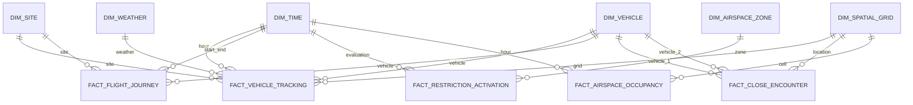

# AeroGrid Phase 2 Data Warehouse Schema

## Status

This is the Phase 2 design overview. It is not implemented. The column-level source of
truth is [`data_dictionary.md`](data_dictionary.md); the visual model is
[`diagrams/aerogrid_schema.dbml`](diagrams/aerogrid_schema.dbml). The design is
synchronized with [`../Phase2/docs/04_data_model.md`](../Phase2/docs/04_data_model.md).

## Schema layers

| Schema | Purpose | Persistence |
|---|---|---|
| `project_staging` | Source-shaped cleaned rows, rejects, manifests, runs, DQ results | Rebuildable from raw + code |
| `project_dw` | Six dimensions and five facts with surrogate keys | Curated analytical model |
| `project_reporting` | Stable views for team analysis and reports | Rebuildable from `project_dw` |

## Star schema

## Dimensions

| Dimension | Grain | Key | Natural key |
|---|---|---|---|
| `dim_time` | One UTC hour | `time_key` | `hour_ts` |
| `dim_site` | One site/region | `site_key` | `site_code` |
| `dim_vehicle` | One vehicle per source | `vehicle_key` | `(source_system, source_entity_id)` |
| `dim_spatial_grid` | One cell/altitude band per site | `grid_key` | `grid_cell_id` |
| `dim_weather` | One station observation | `weather_key` | `(station_icao, observation_ts)` |
| `dim_airspace_zone` | One source zone/feature version | `zone_key` | `(source_system, source_object_id)` |

## Facts

| Fact | Grain | Required keys | Optional keys |
|---|---|---|---|
| `fact_vehicle_tracking` | One real position report | time, site, vehicle, grid | weather |
| `fact_flight_journey` | One real flight/segment | vehicle, site, start/end time | origin/destination grid |
| `fact_close_encounter` | One conflict episode | start time, site, grid, two vehicles | weather |
| `fact_restriction_activation` | One zone evaluation | time, site, zone | none |
| `fact_airspace_occupancy` | One hourly grid/band snapshot | time, site, grid | none |

## Key design

- Surrogate keys are identity `BIGINT` values.
- Facts never use source identifiers as foreign keys.
- Natural keys are unique and used for idempotent upserts.
- Every dimension has a `-1` unknown member.
- Required unresolved dimensions reject the fact; optional unresolved dimensions use
  `-1`.
- `fact_close_encounter` is a role-playing dimension use: `vehicle_key_1` and
  `vehicle_key_2` must be deterministically ordered and distinct.
- `dim_time` is hourly, while facts store exact `event_ts`/`start_ts`.

## Phase 1 refinements

| Area | Phase 1 | Phase 2 |
|---|---|---|
| Dimensions | Five | Six, including `dim_site` |
| Time key | `YYYYMMDDHH` | Identity key plus unique `hour_ts` |
| Fact time | Hourly only | Exact time plus hourly key |
| Provenance | Implicit | Explicit source/run lineage |
| Altitude | One MSL field | MSL/AGL plus datum source |
| Weather | Indirect | Explicit `weather_key` |
| Journey | One time key | Start/end keys and grids |
| Restriction | No effective window | Effective window plus active flag |
| Reporting | Views implied | Explicit `project_reporting` layer |

## Storage and capacity

- Curated database target: under 500 MB; hard free-tier limit 1 GB.
- Raw archives are in object storage, not PostgreSQL.
- Do not load DJI video.
- Use a documented Tartan window and precompute occupancy.
- Index facts by time, site, and foreign keys.
- Stop before 700 MB and ask the human.

## Related documents

- [Data dictionary](data_dictionary.md)
- [DBML](diagrams/aerogrid_schema.dbml)
- [Phase 2 logical model](../Phase2/docs/04_data_model.md)
- [Phase 2 ETL plan](../Phase2/docs/05_etl_pipeline.md)
- [Phase 2 DQ plan](../Phase2/docs/06_data_quality_and_reports.md)
